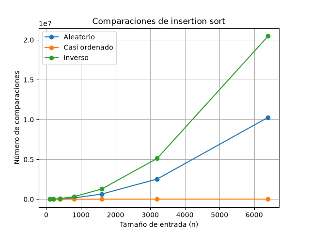
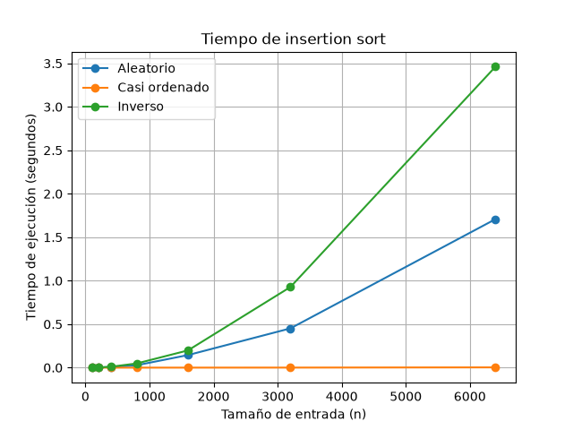
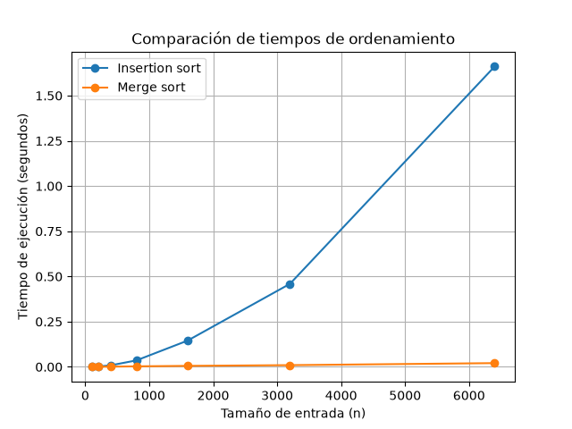

# Laboratorio evaluativo 01 — Fundamentos, complejidad y recurrencias

**Estudiante:** Daniel Felipe Marín Marín
**Curso:** Análisis de algoritmos
**Caso:** Plataforma Tamiza — Secretaría de Salud

## Instrucciones para reproducir el experimento

Para correr el laboratorio se necesita tener Python instalado y el entorno virtual del proyecto activado.

Desde la carpeta del laboratorio:

```
python -m venv .venv
```

Activar el entorno en Windows:

```
.venv\Scripts\activate
```

Instalar las dependencias:

```
pip install -r requirements.txt
```

Ejecutar la Parte 3:

```
python parte3_casos.py
```

Ejecutar la Parte 4:

```
python parte4_complejidad.py
```

Los resultados de las mediciones salen impresos en la terminal y las gráficas quedan guardadas en la carpeta `graficas/`.

---

## Parte 1 — Analizar el algoritmo antes de comprar hardware

Que insertion sort lleve ocho años funcionando no quiere decir que siga siendo la mejor opción para el volumen de datos que maneja Tamiza ahora. Aquí toca separar dos cosas que a veces se confunden: que el algoritmo sea correcto y que sea eficiente.

Que sea correcto significa que al final entrega los registros bien organizados, en este caso de mayor a menor riesgo. Que sea eficiente tiene que ver con cuánto tiempo y cuántos recursos necesita para llegar a ese resultado. Un algoritmo puede dar la respuesta correcta y aun así no servir, si se demora más de lo que el sistema puede esperar.

La restricción que Tamiza está incumpliendo es la ventana de cuatro horas, entre las 2:00 a. m. y las 6:00 a. m. Como el proceso no alcanza a terminar, el centro de contacto recibe una lista que puede estar incompleta o mal ordenada, y eso ya afecta directamente cómo se hacen las llamadas ese día.

Comprar un servidor más rápido puede ayudar un poco, pero no resuelve el problema de raíz. Insertion sort tiene un crecimiento que en el peor de los casos es cuadrático, es decir que si los datos se duplican, el trabajo que hay que hacer no se duplica también, sino que crece mucho más rápido. Pasar de unos cuantos miles de registros a 1.200.000 no es un cambio pequeño, es un salto que puede hacer que el algoritmo se vuelva impráctico aunque el hardware mejore.

Un ejemplo parecido sería un buscador que revisa una lista completa dato por dato para encontrar algo. Si esa lista tiene 20 millones de registros y la aplicación necesita responder en menos de un segundo, el programa puede terminar encontrando lo que se buscaba, pero si se demora cinco segundos porque el dato estaba al final (o no existía), igual está incumpliendo lo que la aplicación necesita.

Por eso, antes de pensar en comprar más hardware, lo primero es mirar qué tan bien se comporta el algoritmo cuando el tamaño de los datos crece, y solo después decidir si toca cambiarlo, mejorar el servidor, o hacer las dos cosas.

---

## Parte 2 — Responsabilidad ambiental y ética de la implementación

Como encargado técnico de Tamiza, la elección del algoritmo no es solo un tema de rendimiento, también tiene efectos en el consumo de recursos y en cómo se atiende a los pacientes.

Por el lado ambiental, un proceso más lento mantiene el servidor prendido y trabajando por más tiempo, lo que se traduce en más uso de procesador, memoria y energía. Puede que en una sola ejecución esto no se note mucho, pero el proceso corre todas las madrugadas, así que ese gasto se va acumulando con los meses y los años. Si se logra que el algoritmo termine más rápido, ese consumo baja y de paso se reduce la necesidad de seguir aumentando la capacidad del servidor cada vez que crecen los datos.

En la parte ética hay más de un problema. El primero afecta directamente a los pacientes con mayor riesgo: si el proceso no termina a tiempo o entrega una lista incompleta, algunos pacientes con riesgo alto pueden quedar sin ser contactados a tiempo, lo que retrasaría su valoración médica. Ese costo lo asume principalmente el paciente, que es justo a quien el sistema debería estar protegiendo primero.

El segundo problema afecta a los operadores del centro de contacto, que reciben una lista incompleta o desordenada y tienen que trabajar con esa información. Esto genera reprocesos, confusión y más carga de trabajo de la necesaria. Aquí el costo lo terminan pagando tanto los operadores como la Secretaría, que es quien debe responder si el proceso falla.

El equipo de desarrollo también se ve afectado, porque es quien tiene que salir a atender el problema, revisar el código bajo presión y buscar una solución rápida. Aun así, la mayor responsabilidad debería estar en quien toma la decisión técnica, porque es quien debe garantizar de entrada que el sistema aguante el volumen de datos con el que trabaja.

Hay otro punto importante: el orden de la lista no es un simple detalle técnico, es lo que define a quién se llama primero. Por eso no basta con que el proceso termine rápido, también tiene que ordenar bien los datos. De nada sirve un algoritmo veloz si deja a un paciente de riesgo alto al final de la lista.

En resumen, la decisión sobre qué algoritmo usar debe pensarse considerando el tiempo de ejecución, el gasto de recursos, qué tan confiable es el código y, sobre todo, el impacto que tiene sobre los pacientes que dependen de este proceso.

---

## Parte 3 — Peor caso, mejor caso y caso promedio

### 3.1 Explicación y predicción

El peor caso es la cantidad máxima de comparaciones (o el mayor tiempo) que el algoritmo puede necesitar para una entrada de tamaño n. No es cualquier entrada grande, sino específicamente la que más trabajo le exige al algoritmo entre todas las posibles de ese tamaño.

El mejor caso es justo lo contrario: la cantidad mínima de comparaciones o el menor tiempo que el algoritmo puede necesitar para una entrada de tamaño n.

El caso promedio es más o menos lo que se esperaría que tarde el algoritmo si se prueba con varias entradas distintas del mismo tamaño. Una forma de aproximarlo es promediando los resultados obtenidos con entradas representativas, como se hizo con el escenario aleatorio de este laboratorio.

Para decidir si Tamiza puede pasar a producción, yo me guiaría principalmente por el peor caso. La razón es que la ventana de cuatro horas no da margen: si el algoritmo funciona bien casi siempre pero falla justo quen los datos llegan en cierto orden, la lista puede quedar incompleta igual. Tratándose de un sistema de salud, no es prudente confiar solo en que "en promedio" va a funcionar.

Antes de correr el experimento, mi predicción fue:

- **Escenario A — Aleatorio:** se aproxima al caso promedio.
- **Escenario B — Casi ordenado:** se aproxima al mejor caso.
- **Escenario C — Orden inverso:** representa el peor caso.
  Esta predicción parte de que insertion sort trabaja poco cuando los datos ya están casi en orden y tiene que hacer muchos más desplazamientos cuando están en el orden contrario al que se necesita.

### 3.2 Resultados experimentales

El código de esta parte está en:

- [Código de la Parte 3](parte3_casos.py)
- [Algoritmos de ordenamiento](algoritmos.py)
- [Generadores de datos](datos.py)





| Tamaño | Aleatorio  | Casi ordenado | Orden inverso |
| ------ | ---------- | ------------- | ------------- |
| 100    | 2.542      | 100           | 4.950         |
| 200    | 9.970      | 203           | 19.900        |
| 400    | 40.436     | 417           | 79.800        |
| 800    | 160.484    | 866           | 319.600       |
| 1.600  | 648.481    | 1.851         | 1.279.200     |
| 3.200  | 2.533.103  | 4.172         | 5.118.400     |
| 6.400  | 10.276.753 | 10.277        | 20.476.800    |

El escenario C (orden inverso) resultó ser el peor caso, con la mayor cantidad de comparaciones y los tiempos más altos: para 6.400 registros hizo 20.476.800 comparaciones y se demoró alrededor de 3,46 segundos.

El escenario B (casi ordenado) fue el mejor caso, ya que necesitó bastantes menos comparaciones: solo 10.277 para 6.400 registros, con un tiempo de apenas 0,00333 segundos.

El escenario A (aleatorio) se comportó como caso promedio: 10.276.753 comparaciones y cerca de 1,71 segundos para 6.400 registros.

En general, los resultados confirman lo que se predijo al inicio. Se nota claramente que insertion sort trabaja muy poco cuando los datos vienen casi ordenados, pero se dispara cuando el orden es el contrario al esperado.

---

## Parte 4 — Complejidad de merge sort e insertion sort

### 4.1 Cálculo teórico

**Recurrencia de merge sort**

Merge sort parte la lista en dos mitades, ordena cada una por separado (de forma recursiva) y después las junta en una sola lista ordenada.

La recurrencia queda así:

```
T(n) = 2T(n/2) + Θ(n)
```

- `2T(n/2)`: son las dos llamadas recursivas, cada una trabajando con la mitad de los datos.
- `Θ(n)`: es el trabajo de mezclar las dos mitades ya ordenadas.
  Para resolver esta recurrencia se usa el método maestro:

```
T(n) = aT(n/b) + f(n)
```

Donde:

```
a = 2
b = 2
f(n) = Θ(n)
```

Calculando:

```
n^(log_b a) = n^(log_2 2) = n
```

Como `f(n) = Θ(n)` es del mismo orden que `n^(log_b a)`, se cae en el caso 2 del método maestro, y entonces:

```
T(n) = Θ(n log n)
```

Esto se cumple para el mejor caso, el caso promedio y el peor caso de merge sort, porque el algoritmo divide la lista en mitades sin importar cómo vengan ordenados los datos de entrada.

```
Mejor caso:    Θ(n log n)
Caso promedio: Θ(n log n)
Peor caso:     Θ(n log n)
```

**Complejidad de insertion sort**

Insertion sort recorre la lista desde el segundo elemento y va comparando cada valor con los anteriores hasta encontrar dónde va.

En el mejor caso (lista ya ordenada), cada elemento solo necesita una comparación, así que el total es aproximadamente `n - 1`, lo que da:

```
Θ(n)
```

En el peor caso (lista en orden contrario), cada elemento nuevo se tiene que comparar con todos los anteriores. La suma queda:

```
1 + 2 + 3 + ... + (n - 1) = n(n - 1) / 2
```

que crece como:

```
Θ(n²)
```

El caso promedio también termina siendo cuadrático, aunque con una constante menor que en el peor caso:

```
Θ(n²)
```

**Tabla de complejidades**

| Algoritmo      | Mejor caso | Caso promedio | Peor caso  |
| -------------- | ---------- | ------------- | ---------- |
| Insertion sort | Θ(n)       | Θ(n²)         | Θ(n²)      |
| Merge sort     | Θ(n log n) | Θ(n log n)    | Θ(n log n) |

### 4.2 Validación experimental

El código de esta parte está en:

- [Código de la Parte 4](parte4_complejidad.py)
- [Algoritmos de ordenamiento](algoritmos.py)



| Tamaño | Insertion sort | Merge sort   |
| ------ | -------------- | ------------ |
| 100    | 0,00039797 s   | 0,00044640 s |
| 200    | 0,00184523 s   | 0,00054833 s |
| 400    | 0,00868577 s   | 0,00131130 s |
| 800    | 0,03580240 s   | 0,00293783 s |
| 1.600  | 0,14522233 s   | 0,00553657 s |
| 3.200  | 0,45912933 s   | 0,00950570 s |
| 6.400  | 1,66101520 s   | 0,02074203 s |

En la gráfica se ve cómo insertion sort empieza a dispararse a medida que crece n, mientras que merge sort sube de forma mucho más controlada. Para 6.400 registros, insertion sort se demoró 1,66 segundos aproximadamente, contra 0,0207 segundos de merge sort, es decir, cerca de 80 veces más rápido en esta medición.

Esto va de la mano con la teoría: insertion sort en promedio es Θ(n²), mientras que merge sort es Θ(n log n). Con tamaños pequeños casi no se nota la diferencia (para n=100, merge sort incluso fue un poco más lento que insertion sort, 0,00044640 s contra 0,00039797 s), porque merge sort tiene un costo extra por dividir y volver a unir las listas mediante recursión. Pero apenas el tamaño empieza a crecer, esa ventaja se invierte y la superioridad de merge sort se hace evidente.

### 4.3 Concepto técnico para la Secretaría de Salud

**Para:** Equipo de ingeniería de la Secretaría de Salud
**Asunto:** Recomendación de algoritmo de ordenamiento para la plataforma Tamiza

Después de revisar el comportamiento de los dos algoritmos y las mediciones hechas en este laboratorio, la recomendación es cambiar a merge sort para el proceso de ordenamiento de Tamiza. La razón principal es que el canal por donde llegan los datos puede cambiar en cualquier momento, y no conviene que el sistema dependa de que los registros lleguen siempre en un orden favorable.

Insertion sort funciona muy bien cuando la lista ya viene casi ordenada, pero su comportamiento cambia demasiado según cómo lleguen los datos. En las pruebas, el escenario casi ordenado tardó apenas 0,00333 segundos para 6.400 registros, mientras que el escenario en orden inverso tardó 3,46 segundos para el mismo tamaño. Esa diferencia tan grande es un riesgo, porque no hay garantía de que los datos siempre lleguen en las condiciones más favorables.

Merge sort, en cambio, se comporta de forma más pareja sin importar el orden de entrada, porque siempre divide y combina la lista de la misma manera. En la comparación hecha con datos aleatorios, insertion sort tardó 1,6610 segundos para 6.400 registros, mientras que merge sort tardó 0,02074 segundos. La diferencia se hace más grande entre más crece el tamaño de los datos.

Sobre los 1.200.000 registros reales de Tamiza, es importante aclarar que lo que se presenta aquí es una estimación, no una medición directa. Tomando como referencia el tiempo de insertion sort en 6.400 registros (1,66101520 s) y suponiendo que su crecimiento se mantiene cuadrático, el tiempo estimado sube a cerca de 58.395 segundos, es decir, poco más de 16 horas. Esto ya supera por mucho la ventana de cuatro horas disponible.

Para merge sort, usando la misma referencia de 6.400 registros (0,02074203 s) pero con un crecimiento de n log n, la estimación da un tiempo de apenas unos 6 segundos para 1.200.000 registros. Esta cifra sigue siendo una aproximación, ya que el resultado real depende del hardware, la memoria disponible y otros factores del servidor de producción, pero da una idea clara de la diferencia entre los dos algoritmos.

Con estos números, no se recomienda resolver el problema solo comprando un servidor más rápido. La diferencia entre 1,66 segundos y 0,0207 segundos para el mismo tamaño de datos muestra que cambiar el algoritmo puede tener un impacto mucho mayor que simplemente mejorar el hardware.

También hay que tener en cuenta que merge sort necesita memoria adicional para hacer las mezclas, lo cual es un costo real, pero que vale la pena frente al riesgo de que insertion sort no alcance a terminar dentro del tiempo disponible. Además, quedarse con una sola implementación (merge sort) es más fácil de mantener que tener que sostener varias versiones dependiendo del tipo de entrada.

En resumen, se recomienda pasar a merge sort, hacer pruebas adicionales con datos reales o representativos del volumen completo, y monitorear que el proceso siempre termine dentro de la ventana de cuatro horas, asegurando que los pacientes de mayor riesgo queden siempre primero en la lista de llamadas.

---

## Conclusión general

Este laboratorio deja claro que un algoritmo puede dar el resultado correcto y aun así no ser el adecuado para un sistema real. En el caso de Tamiza, el volumen de datos hace que insertion sort tenga tiempos aceptables en algunos escenarios, pero completamente inviables en otros.

Merge sort mostró un comportamiento más estable y mejores tiempos a medida que crecía el tamaño de la entrada, lo que lo convierte en la opción más razonable para ordenar los 1.200.000 registros de la plataforma dentro de la ventana de cuatro horas.

Comprar más hardware puede ayudar como complemento, pero no reemplaza la necesidad de elegir bien el algoritmo. La decisión final debe apoyarse en la teoría, en las mediciones hechas y en el impacto real que tiene el sistema sobre la atención de los pacientes.
