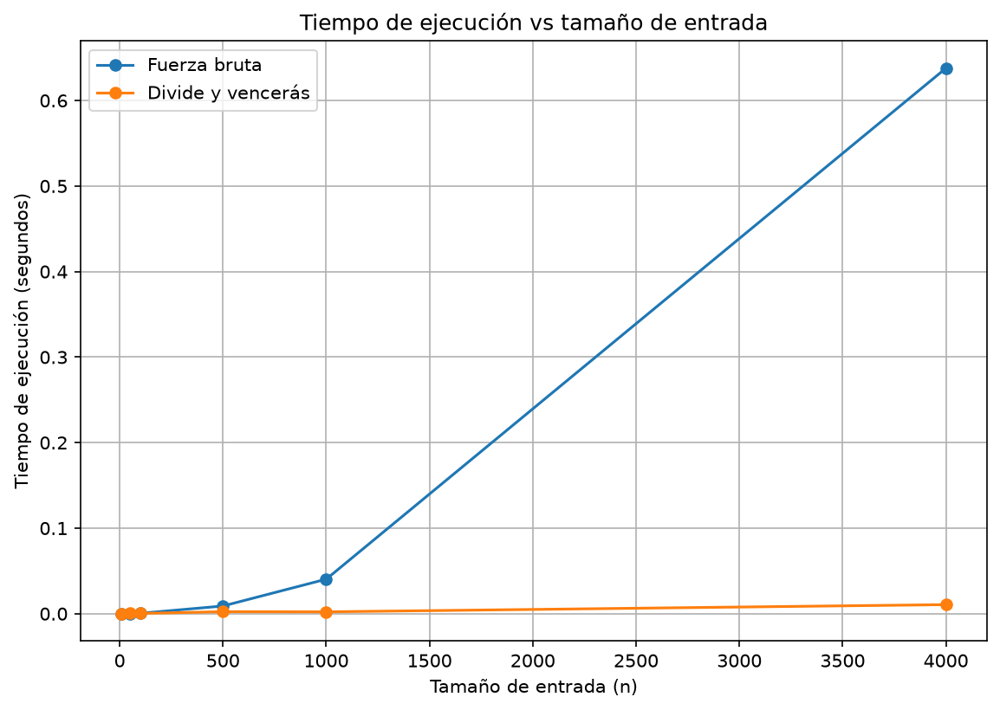

# Laboratorio evaluativo 02 — Dividir y vencer

**Nombre:** Daniel Felipe Marín Marín

## Reproducción del experimento

El laboratorio lo corrí con Python 3.14.3 en un entorno virtual que tiene `matplotlib` instalado.

Para activar el entorno virtual:

```powershell
.\venv\Scripts\Activate.ps1
```

Para ejecutar las pruebas:

```powershell
Set-Location laboratorios\lab2-divide-y-vencer
python pruebas.py
```

Para ejecutar la medición:

```powershell
Set-Location laboratorios\lab2-divide-y-vencer
python medicion.py
```

## Parte 1 — Implementar y verificar

[Ver ](subarreglo.py)[`subarreglo.py`](subarreglo.py)

[Ver ](pruebas.py)[`pruebas.py`](pruebas.py)

Para encontrar el subarreglo de mayor suma hice dos soluciones: una de fuerza bruta y otra con divide y vencerás.

La de fuerza bruta prueba todos los tramos posibles y va acumulando la suma de cada uno. La de divide y vencerás parte el arreglo en dos mitades y mira tres casos: que el mejor tramo esté todo en la mitad izquierda, todo en la derecha, o que cruce por el punto medio.

Para ese último caso hice la función `suma_cruzada`, que busca la mejor combinación entre los elementos de las dos mitades.

En las pruebas revisé la serie de ocho días de la situación problema, un arreglo de un solo elemento, uno con todos los valores negativos, uno con todos positivos, un caso donde el mejor tramo cruza el punto medio y 20 listas aleatorias.

Con la serie principal:

```text
[-3, 5, -2, 8, -6, 3, 9, -4]
```

las dos soluciones dan una suma máxima de `17`, que corresponde al tramo entre los días 2 y 7.

## Parte 2 — Medir y graficar

[Ver ](medicion.py)[`medicion.py`](medicion.py)

Medí el tiempo de ejecución de los dos algoritmos con `time.perf_counter()`. Para cada tamaño generé una lista de enteros entre -100 y 100 con una semilla fija, y usé la misma lista para los dos algoritmos para que la comparación fuera justa.

Los tamaños que usé fueron:

```text
10, 50, 100, 500, 1000 y 4000
```

Los resultados fueron:

| Tamaño (n) | Fuerza bruta (s) | Divide y vencerás (s) |
| ---------- | ---------------: | --------------------: |
| 10         |         0.000009 |              0.000025 |
| 50         |         0.000123 |              0.000457 |
| 100        |         0.000439 |              0.000279 |
| 500        |         0.008972 |              0.002326 |
| 1000       |         0.040345 |              0.002141 |
| 4000       |         0.637808 |              0.010570 |

En cada tamaño comprobé que los dos algoritmos dieran la misma suma máxima.

### Gráfica



En la gráfica se ven las dos curvas en los mismos ejes. Se nota que cuando aumenta el tamaño de la entrada, la fuerza bruta se dispara mucho más rápido que divide y vencerás.

## Parte 3 — Análisis

### 1. Recurrencia

En cada paso, `subarreglo_maximo` divide la lista en dos mitades y resuelve cada una por separado. Por eso hace dos llamadas con un tamaño cercano a `n/2`. Para revisar el caso cruzado, `suma_cruzada` recorre desde el medio hacia ambos lados. Entre los dos recorridos revisa `n` elementos, así que ese paso cuesta `Θ(n)`.

La recurrencia es:

```text
T(n) = 2T(n/2) + Θ(n)
```

Para el método maestro, `a = 2`, `b = 2` y `f(n) = Θ(n)`. El término de comparación es:

```text
n^(log_b(a)) = n^(log_2(2)) = n
```

Como `f(n) = Θ(n) = Θ(n^(log_b(a)) log^0 n)`, se cumple la condición del caso 2 y el tiempo queda en `Θ(n log n)`. En fuerza bruta hay dos ciclos: se prueban `n(n+1)/2` tramos y la suma se va acumulando al avanzar por cada uno. Por eso el tiempo total es `Θ(n²)`.

### 2. Lo medido contra lo esperado

Comparé los tamaños 500 y 1000, donde `n` se duplica. Estos son los factores que obtuve:

```text
0.040345 / 0.008972 ≈ 4.50
0.002141 / 0.002326 ≈ 0.92
```

Para fuerza bruta, el factor `4.50` se acerca a 4, que es lo esperado para `Θ(n²)`. En divide y vencerás salió `0.92`, aunque por `Θ(n log n)` esperaría cerca de `2.22`. Como cada tamaño se midió una sola vez, pudo influir el ruido de la medición. En la gráfica sí se ve que para `n = 4000` fuerza bruta tarda `0.637808 s` y divide y vencerás `0.010570 s`.

### 3. Tamaños pequeños

En mis mediciones, fuerza bruta fue más rápida con `n = 10` y `n = 50`. Divide y vencerás empezó a ganar en `n = 100`. Para listas pequeñas, las llamadas recursivas agregan trabajo y todavía no se nota el ahorro. Con listas grandes, la diferencia entre `Θ(n²)` y `Θ(n log n)` pesa mucho más.

### 4. ¿Cuándo conviene dividir?

Si quisiera encontrar solo el número más grande de una lista, podría dividirla, buscar el máximo de cada mitad y comparar esos dos resultados. La comparación final cuesta `Θ(1)`, así que la recurrencia sería:

```text
T(n) = 2T(n/2) + Θ(1)
```

El método maestro da `T(n) = Θ(n)`, lo mismo que revisar todos los números una vez. En este caso dividir no mejora el tiempo de forma importante: al final solo se hace una comparación. Para el subarreglo máximo sí conviene, porque se pasa de `Θ(n²)` a `Θ(n log n)`.

### 5. Concepto para la gerente

Para la cooperativa recomendaría divide y vencerás, sobre todo si van a analizar historiales grandes. Tomando como referencia `n = 4000`, estimé el tiempo para un millón de registros usando el crecimiento cuadrático de fuerza bruta:

```text
0.637808 × (1.000.000 / 4.000)²
≈ 39.863 segundos
```

Eso equivale a unas **11 horas**. Para divide y vencerás usé el crecimiento `n log n`:

```text
0.010570 ×
(1.000.000 log₂(1.000.000)) /
(4.000 log₂(4.000))
≈ 4.40 segundos
```

Los dos resultados son **estimaciones**, porque el tiempo real depende del computador y del entorno. De todos modos, sirven para ver por qué elegiría divide y vencerás para procesar tantos registros.
