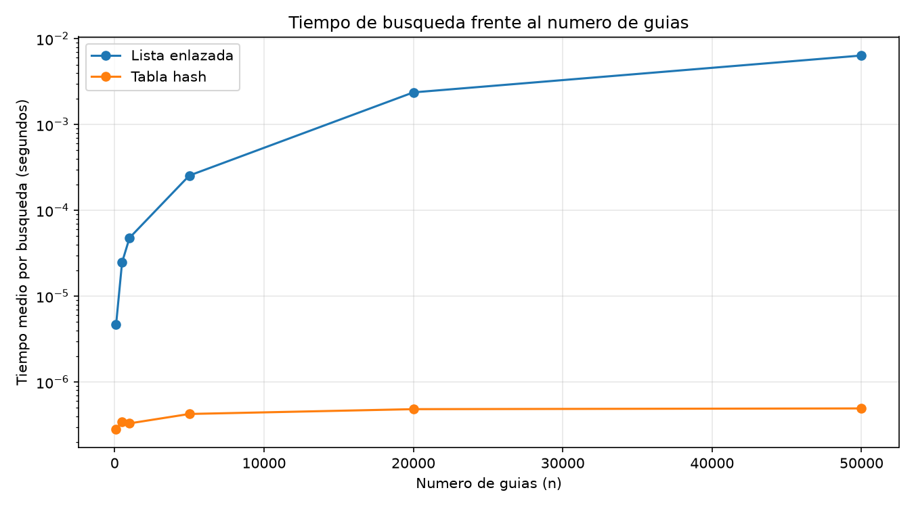
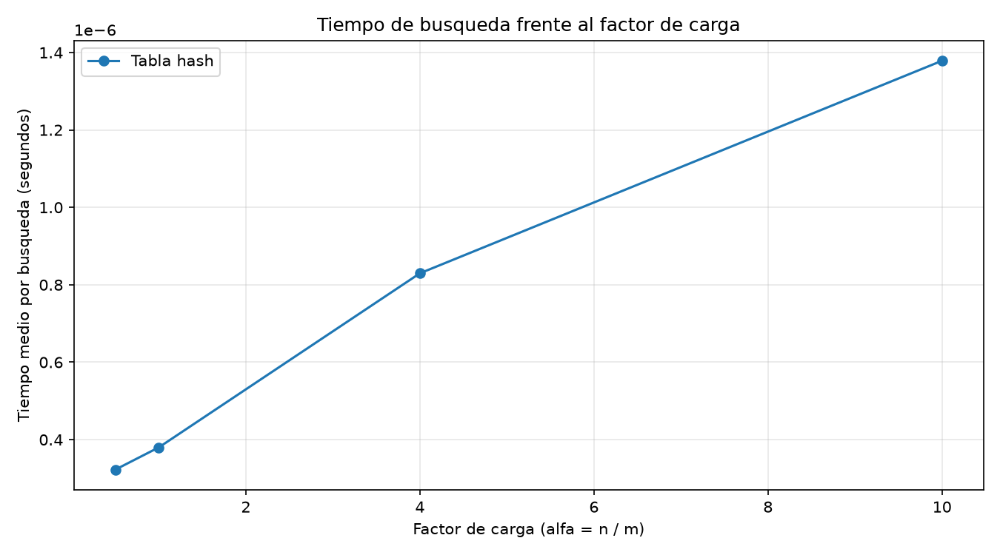

# Laboratorio 3 — Estructuras de datos: lista enlazada vs. tabla hash

**Estudiante:** Daniel Felipe Marin Marin

**Curso:** Análisis de Algoritmos — Ingeniería de Sistemas

## Cómo reproducir el laboratorio

Requiere Python 3.10 o superior (se usan anotaciones como `Nodo | None`). Desde la raíz del repositorio (`curso-analisis-algoritmos/`):

```powershell
# Windows (PowerShell)
python -m venv .venv                 # solo la primera vez
.\.venv\Scripts\Activate.ps1
python -m pip install -r requirements.txt
python laboratorios\lab3-estructuras-datos\pruebas.py
python laboratorios\lab3-estructuras-datos\medicion.py
```

```bash
# Linux / macOS
python3 -m venv .venv                # solo la primera vez
source .venv/bin/activate
python -m pip install -r requirements.txt
python laboratorios/lab3-estructuras-datos/pruebas.py
python laboratorios/lab3-estructuras-datos/medicion.py
```

`pruebas.py` termina sin errores si todos los `assert` se cumplen. `medicion.py` genera `graficas/lista_vs_tabla.png` y `graficas/tiempo_vs_alfa.png`.

## Parte 1 — Implementación y pruebas

Código: [`estructuras.py`](estructuras.py) · [`pruebas.py`](pruebas.py)

Implementé a mano una `ListaEnlazada` (inserción al inicio en Θ(1) y búsqueda iterativa con `while`) y una `TablaHash` con encadenamiento, donde cada casilla es una `ListaEnlazada` y la función hash es `k mod m`. No usé `dict`, `set` ni la función `hash()` de Python dentro de `estructuras.py`. El código sigue PEP 8, con type hints y docstrings estilo Google.

`pruebas.py` usa `assert` y cubre estos casos:

- Búsqueda exitosa y búsqueda infructuosa (devuelve `None`) en la lista y en la tabla.
- Colisión forzada con `m = 7`: las guías 10, 24 y 17 caen en la casilla 3, las tres se insertan y se encuentran después, y la lista de esa casilla tiene longitud 3.
- `factor_carga()` da `3/7` después de esas tres inserciones.
- 20 colecciones aleatorias en las que lista y tabla devuelven el mismo resultado, tanto para guías que existen como para guías que no existen.

## Parte 2 — Mediciones y gráficas

Código: [`medicion.py`](medicion.py)

**Cómo medí.** Las guías son enteros distintos de diez dígitos generados con semilla fija, y las mismas guías se cargan en la lista y en la tabla para cada n. Las guías inexistentes salen de `generar_guias_inexistentes` (semilla 7). Para cada n hice 200 búsquedas de guías inexistentes y repetí la medición 3 veces, promediando. Con `time.perf_counter()` cronometré solo las búsquedas, nunca la construcción de las estructuras ni la generación de datos. Dentro del experimento verifiqué, con una muestra de guías existentes, que lista y tabla devuelven el mismo estado.

### Experimento A: lista enlazada vs. tabla hash

La tabla usa un m primo cercano a n/2, así que α queda alrededor de 2. Tiempo medio por búsqueda de una guía inexistente (1 µs = 10⁻⁶ s):

| Guías (n) | m (primo) | α = n/m | Lista (µs) | Tabla (µs) |
| --------: | --------: | ------: | ---------: | ---------: |
|       100 |        53 |   1,887 |      4,676 |      0,284 |
|       500 |       251 |   1,992 |     24,788 |      0,346 |
|     1.000 |       503 |   1,988 |     47,907 |      0,330 |
|     5.000 |     2.503 |   1,998 |    254,615 |      0,425 |
|    20.000 |    10.007 |   1,999 |  2.370,291 |      0,483 |
|    50.000 |    25.013 |   1,999 |  6.372,849 |      0,493 |



En la gráfica el eje vertical está en escala logarítmica, porque la lista tarda hasta unas 13.000 veces más que la tabla y en escala lineal la curva de la tabla se vería pegada al cero.

### Experimento B: efecto del factor de carga

Con n = 20.000 fijo y distintos m, tiempo medio por búsqueda de una guía inexistente:

|   α |      m | Tabla (µs) |
| --: | -----: | ---------: |
| 0,5 | 40.000 |      0,322 |
|   1 | 20.000 |      0,380 |
|   4 |  5.000 |      0,830 |
|  10 |  2.000 |      1,379 |



## Parte 3 — Análisis

### 1. Costo teórico

Para una guía inexistente, la lista tiene que recorrer los n nodos hasta llegar a `None`, porque solo así sabe que no está. Cada nodo cuesta un tiempo constante (comparar y avanzar), así que el total es proporcional a n: Θ(n).

En la tabla se calcula `k mod m` en Θ(1) y se recorre solo la cadena de esa casilla, completa porque la guía no existe. Su longitud esperada es n/m = α, por eso el costo promedio es Θ(1 + α). Esto depende del supuesto de hash uniforme simple: cada guía cae en cualquiera de las m casillas con la misma probabilidad y sin depender de las otras. Si todas cayeran en la misma casilla, esa cadena tendría n nodos, la tabla sería una lista enlazada y buscar costaría Θ(n).

### 2. Lo medido contra lo esperado

**Experimento A.** Tomo dos valores consecutivos, n = 20.000 y n = 50.000 (n × 2,5). La lista pasó de 2.370 µs a 6.373 µs (× 2,69), casi proporcional a n, como se espera de Θ(n). La tabla pasó de 0,483 µs a 0,493 µs (× 1,02): prácticamente igual, como Θ(1) con α fijo cerca de 2. Entre 5.000 y 20.000 (n × 4) la lista se multiplicó por 9,3, más que lineal; no lo comprobé, pero sospecho que con tantos nodos ya no caben en la caché del procesador. En todo el rango, de n = 100 a n = 50.000 (500 veces más guías), la tabla solo subió de 0,284 a 0,493 µs (× 1,7).

**Experimento B.** Al subir α el tiempo sube: 0,322 µs (α = 0,5), 0,380 (α = 1), 0,830 (α = 4) y 1,379 (α = 10). Entre α = 0,5 y α = 10, α se multiplicó por 20, pero el tiempo solo por 4,28. Con Θ(1 + α) se esperaría (1 + 10)/(1 + 0,5) ≈ 7,3. La diferencia es coherente: hay un costo fijo (calcular el hash, llamar la función, cronometrar) que no depende de α. Según mis puntos, son unos 0,27 µs fijos más unos 0,11 µs por cada unidad de α. La tendencia es creciente y casi lineal en α, coherente con Θ(1 + α).

### 3. Colisiones

Una colisión ocurre cuando dos guías distintas caen en la misma casilla, es decir, h(k₁) = h(k₂). Pasa aunque haya más casillas que guías porque las guías posibles (diez dígitos) son muchísimas más que las m casillas, así que la función no puede darle una casilla propia a cada una, y además con guías al azar es normal que algunas coincidan. Ejemplo: con m = 7, 10 mod 7 = 3, 24 mod 7 = 3 y 17 mod 7 = 3.

- **Encadenamiento:** las tres guías quedan en la lista de la casilla 3. Ventaja: es simple, insertar cuesta Θ(1) y α puede ser mayor que 1. Costo: memoria extra por nodos y punteros, y hay que recorrer la cadena.
- **Direccionamiento abierto:** todo se guarda en el mismo arreglo. Con sondeo lineal, 10 ocupa la casilla 3, 24 pasa a la 4 y 17 a la 5. Ventaja: no hay nodos ni punteros y se aprovecha mejor la caché. Costo: α no puede pasar de 1, se degrada rápido cuando la tabla se llena (se forman grupos de casillas ocupadas) y borrar es más complicado.

### 4. Tabla hash o árbol de búsqueda

Para "guías entre X y Y" la tabla no sirve bien: ubica las guías según `k mod m`, que no respeta el orden, así que guías cercanas quedan en casillas lejanas y habría que revisar toda la tabla, Θ(m + n). El árbol binario de búsqueda guarda las claves ordenadas: se baja hasta X en Θ(h) y se recorre en inorden hasta Y, con costo Θ(h + r), donde r es el número de guías del rango.

Si las 400.000 guías llegan ya ordenadas, cada nueva guía es mayor que todas las anteriores y va a la derecha: el árbol queda como una lista, con altura de 399.999 aristas. Una búsqueda toma hasta 400.000 comparaciones (unas 200.000 en promedio) y construirlo cuesta cerca de n²/2 = 8 × 10¹⁰ comparaciones. En un árbol equilibrado la altura es ⌊log₂ 400.000⌋ = 18 aristas (19 niveles), o sea unas 19 comparaciones, unas 21.000 veces menos que en el caso degenerado.

### 5. Concepto para la jefa de operaciones

Recomiendo usar las dos estructuras sobre los mismos datos: una tabla hash para consultar el estado de una guía (con 50.000 guías tardó 0,49 µs frente a 6.373 µs de la lista) y un árbol equilibrado (AVL o rojo-negro) para el monitoreo por rango. El costo es más memoria y tener que insertar cada guía en ambas.

**Estimación (no medida) con 5.000.000 de envíos, guía inexistente.** Lista: mi curva es casi una recta (× 2,69 con n × 2,5), así que el tiempo es proporcional a n; 5.000.000 es 100 veces 50.000, entonces 6.373 µs × 100 ≈ 0,64 s. Como entre 5.000 y 20.000 crecí más que lo lineal, el valor real podría ser mayor. Tabla: si aumento m con n para mantener α ≈ 2, la curva es casi plana, así que esperaría el mismo orden que los 0,49 µs medidos, quizás 0,5 a 1 µs por más fallos de caché con tantos datos. Es una estimación apoyada en mis gráficas, no una medición.
